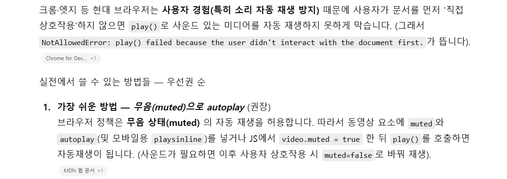
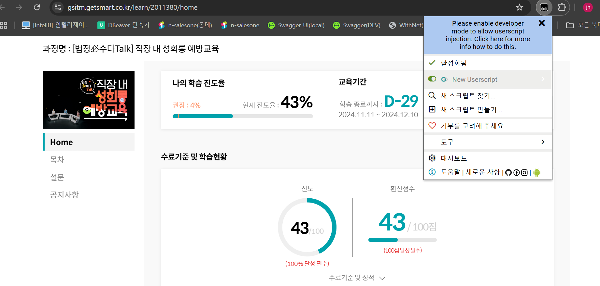
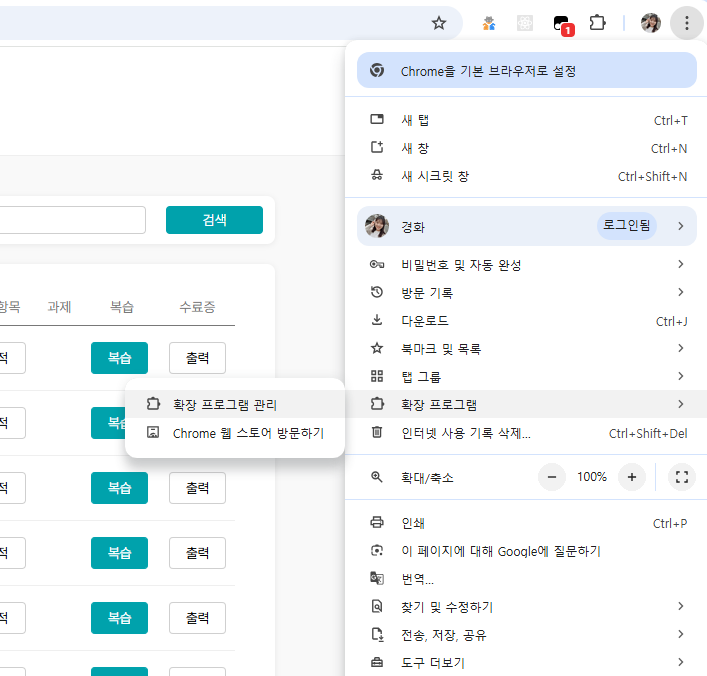
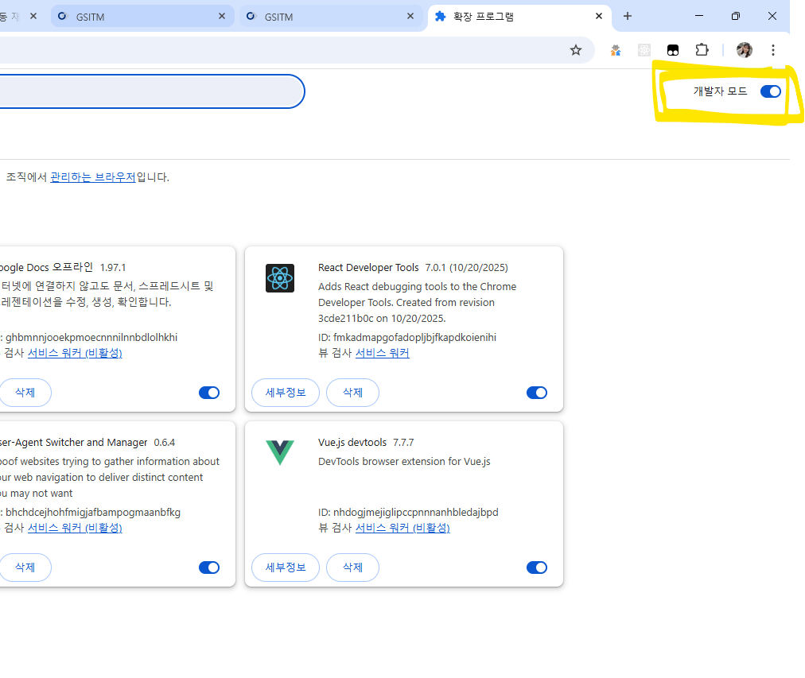
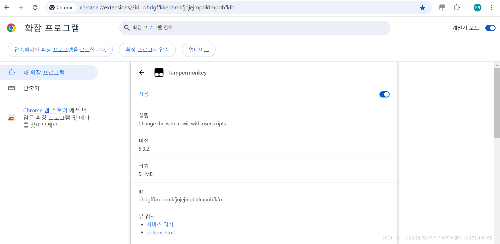
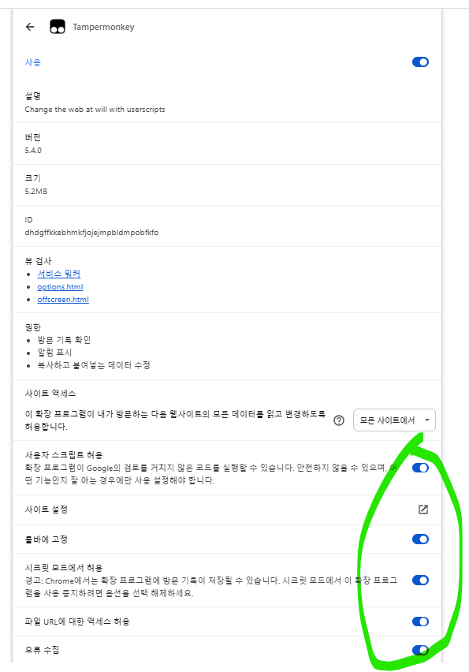
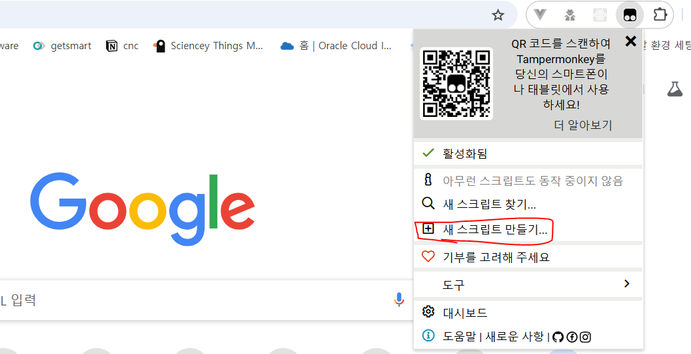
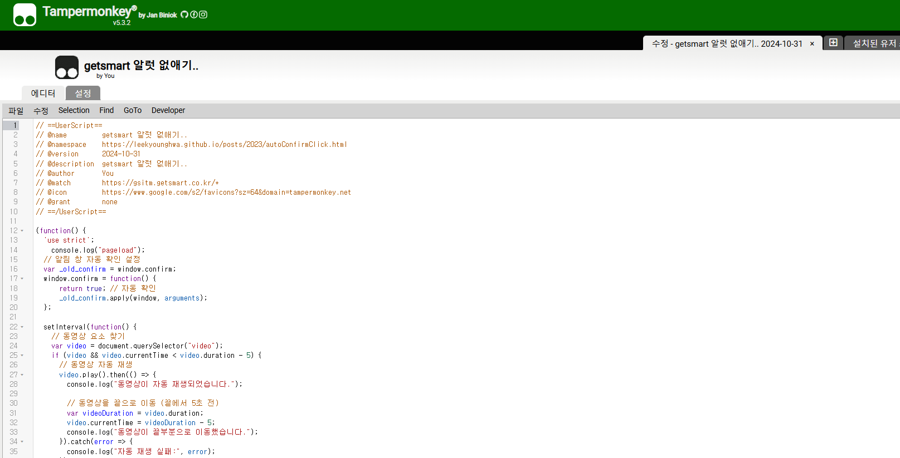

> ## 2026년 V4 업데이트
>
> 올해는 끝으로 땡기기가 막혔네요 ㅠ 땡겨도 원래 위치로 돌아갑니다.  
> 그래서 끝으로 이동 대신 플레이어 배속 메뉴의 최대 배속으로 재생하도록 바꿨습니다.  
> 그리고 `hrdgsitm.getsmart.co.kr` 처럼 주소가 다른 과정도 있어서 `@match`를 `https://*.getsmart.co.kr/*` 로 바꿨어요.  
> 동영상 없는 페이지에서 나던 오류도 고치고 `alert`도 같이 없앱니다.  
> 밑에 [스크립트](#4-스크립트-작성후-ctrls-저장-상단-주석도-중요합니다용-전체-복사-후-붙여넣기-해주세요) 그대로 복붙하시면 됩니다~!

<details class="custom-block details">
<summary>History</summary>

> ## 2025년 V3
>
> 어느덧 3주년을 맞이한 getSmart 자동재생 입니다! 올해는 또 넘어가기가 안되는군용?ㅋㅋ  
> 소스상에서는 땡겨집니다(다행)  
> 그리고 브라우저 정책상 자동재생이 막혔더군요 깨알 상식 공유차원에서 한번 읽어보십숑  
> `video.muted = true; ` 한줄 추가했습니다.
> 

> ## 2024년
>
> 아니 원래 넘어가기가 안됬었는데 넘어가지는군요?  
> 버튼을 100번 누르느냐 세팅해놓고 자동 재생 시키느냐는 여러분들의 선택...  
> ++ 영재M 의 스크립트 보완(감사감사) 에 제가 더 수정함  
> ++ 지현M 문의 보완

> ## 2023년
>
> getSmart 라는 사내 교육프로그램이 있는데 다음 차시로 넘어갈때마다 확인 누르는게 너무 귀찮다.  
> 다음 차시로 자동으로 넘어가게 alert(confirm)을 없애는 스크립트를 짜봤다.  
> 의무교육들을때 크롬 탭에서 한꺼번에 4개의 강좌를 동시에 돌리면 됨.  
> 다음 페이지로 넘어갈때 화면에서 발생하는 alert 이나 confirm 없애고 재생 위치를 뒤쪽으로 당겨 자동으로 재생시켜 줍니다
>
> - 참고 : [detect-if-an-alert-or-confirm-is-displayed-on-a-page](https://stackoverflow.com/questions/4866986/detect-if-an-alert-or-confirm-is-displayed-on-a-page)

</details>
## 1. [Tampermonkey 크롬 확장 프로그램](https://chromewebstore.google.com/detail/tampermonkey/dhdgffkkebhmkfjojejmpbldmpobfkfo) 설치해 주세용. 한번 세팅해놓으면 두고두고 사용 가능

## 2. **_!!!확장 프로그램 개발자 모드 켜주세요!!!_** 안키면 파란 메시지 뜨면서 작동이 안됩니당 ㅠ

`크롬 더보기` > `확장 프로그램` > `확장 프로그램 관리` > 우측 상단 `개발자 모드` 활성화








<div class="custom-block tip">
<p class="custom-block-title">개발자모드 활성화 먹지 않는다면</p>

개발자 모드 활성화 했는데도 자꾸 파란 창 뜨면서 개발자 모드 활성화 해라 뜬다면  
아래와 같이 모든 토글 활성화 시켜 주세요
`thanks to siver joy`


</div>
## 3. Tampermonkey 스크립트 어떻게 공유하는지 모르겠군용 하나 만들어 주세요



## 4. 스크립트 작성후 `ctrl`+`s` 저장! (상단 주석도 중요합니다용 전체 복사 후 붙여넣기 해주세요)

```js
// ==UserScript==
// @name         getsmart 알럿 없애기, 자동 재생, 최대 배속
// @namespace    https://leekyounghwa.github.io/posts/2023/autoConfirmClick.html
// @version      2026-11-06
// @description  getsmart 알럿 자동 확인, 음소거 자동 재생, 플레이어 최대 배속 설정
// @match        https://*.getsmart.co.kr/*
// @icon         https://www.google.com/s2/favicons?sz=64&domain=tampermonkey.net
// @run-at       document-start
// @grant        none
// ==/UserScript==

(function () {
  "use strict";
  console.log("pageload");

  // 플레이어 배속 메뉴의 최대값으로 맞춰 주세요 (예: 1.5, 2)
  const MAX_RATE = 2;

  // 알림 창 자동 확인 설정
  window.confirm = () => true;
  window.alert = () => {};

  // 영상마다 배속은 한 번만 설정
  const applied = new WeakSet();

  setInterval(function () {
    document.querySelectorAll("video").forEach(function (video) {
      // 동영상 정보 로드 전이면 다음 체크 때 다시 확인
      if (!isFinite(video.duration) || video.duration <= 0) return;

      if (!applied.has(video)) {
        video.playbackRate = MAX_RATE;
        applied.add(video);
        console.log("배속 설정:", MAX_RATE);
      }

      // 멈춰 있으면 음소거 후 자동 재생 (브라우저 자동재생 정책)
      if (video.paused && !video.ended) {
        video.muted = true;
        video.play().catch((error) => console.log("자동 재생 실패:", error));
      }
    });
  }, 3000); // 3초마다 체크
})();
```



<div class="custom-block tip">
<p class="custom-block-title">최대 배속 확인하는 법</p>

동영상 하단의 `1.0x`, `배속`, 톱니바퀴 버튼을 눌러 나오는 목록 중 가장 큰 값을 `MAX_RATE`에 넣어 주세요.  
한 차시 돌려보고 진도율이 안 올라가면 한 단계 낮춰 주시면 됩니다.

</div>

## 5. 동영상 실행

창 띄워두고 다른 일 하시면 알아서 재생됩니다.

멈추면 다 종료된겁니다..!

문의사항 있으면 언제든지 팀즈주세용~

# 인프런용

```js
// ==UserScript==
// @name         인프런 건너뛰기
// @namespace    http://tampermonkey.net/
// @version      2025-11-11
// @description  인프런 강의 자동 건너뛰기
// @author       You
// @match        https://www.inflearn.com/courses/lecture?*
// @icon         https://www.google.com/s2/favicons?sz=64&domain=inflearn.com
// @grant        none
// ==/UserScript==
(function () {
  "use strict";

  console.log("인프런 건너뛰기 start");

  let clickingNext = false; // 중복 클릭 방지 플래그

  setInterval(async function () {
    const video = document.querySelector("video");

    if (video && video.currentTime != video.duration) {
      video.muted = true;
      if (video.currentTime < video.duration - 5) {
        try {
          await video.play();
          console.log("동영상이 자동 재생되었습니다.");
          video.currentTime = video.duration - 5;
          console.log("동영상이 끝부분으로 이동했습니다.");
        } catch (error) {
          console.log("자동 재생 실패:", error);
        }
      }
    } else {
      const nextBtn = Array.from(
        document.querySelectorAll(
          ".mantine-UnstyledButton-root.mantine-Button-root"
        )
      ).find((btn) => btn.textContent.includes("다음"));

      if (nextBtn && !clickingNext) {
        clickingNext = true; // 클릭 진행 중
        console.log("'다음' 버튼을 5초 후 클릭 예정...");
        await new Promise((resolve) => setTimeout(resolve, 5000)); // 10초 대기
        nextBtn.click();
        console.log("'다음' 버튼 클릭 완료!");
        clickingNext = false; // 클릭 완료 후 플래그 해제
      } else if (!nextBtn) {
        console.log("'다음' 버튼을 찾을 수 없습니다.");
      }
    }
  }, 5000);
})();
```
