- [리액트 환경설정](./day1.md)
- [라이프사이클 메서드](./day2.md)
- [Hooks](./day3.md)
- [컴포넌트 스타일링](./day4.md)
- [todo실습 - 환경구성, 불변성, react-virtualized](./day5.md)
- [라우터](./day6.md)
- `axios`


## 동기적(synchronous) vs 비동기적(asynchronous)

```mermaid
gantt
    title 동기적(synchronous) vs 비동기적(asynchronous)
    dateFormat X
    axisFormat %s
    section 동기적
    1   : 0, 3
    2   : 3, 4
    3   : 4, 6
    4   : 6, 7
    section 비동기적
    1   : 0, 3
    2   : 0, 1
    3   : 0, 2
    4   : 0, 1
```



## async/await

- [https://triplexblog.kr/170](https://triplexblog.kr/170)
- async/await : Promise를 더욱 쉽게 사용할 수 있도록 해 주는 ES2017(ES8) 문법. Promise가 끝날 때까지 기다리고, 결과 값을 특정 변수에 담을 수 있다.
- 함수의 앞부분에 async 키워드를 추가하고, 해당 함수 내부에서 Promise의 앞부분에 await 키워드를 사용
- axios : HTTP 요청을 Promise 기반으로 처리하는 자바스크립트 HTTP 클라이언트 라이브러리

```js
function increment(number) {
  const promise = new Promise((resolve, reject) => {
    // resolve는 성공, reject는 실패
    setTimeout(() => {
      const result = number + 10;
      if (result > 50) {
        // 50보다 높으면 에러 발생시키기
        const e = new Error("NumberTooBig");
        return reject(e);
      }
      resolve(result); // number 값에 +10 후 성공 처리
    }, 1000);
  });
  return promise;
}

async function runTasks() {
  try {
    // try/catch 구문을 사용하여 에러를 처리합니다.
    let result = await increment(0);
    console.log(result);
    result = await increment(result);
    console.log(result);
    result = await increment(result);
    console.log(result);
    result = await increment(result);
    console.log(result);
    result = await increment(result);
    console.log(result);
    result = await increment(result);
    console.log(result);
  } catch (e) {
    console.log(e);
  }
}
runTasks();
```
